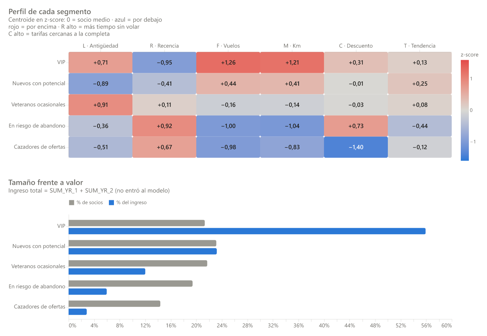

# Segmentación avanzada de clientes con LRFMC

[](https://github.com/freddxvill/segmentacion-clientes-aerolinea/actions/workflows/ci.yml)
[](https://freddxvill.github.io/segmentacion-clientes-aerolinea/)

[](https://freddxvill.github.io/segmentacion-clientes-aerolinea/)

Segmentación de los 62.044 socios de un programa de viajero frecuente de una aerolínea con el
modelo **LRFMC** y **K-Means**: cinco segmentos con nombre comercial, perfil, pruebas estadísticas
y recomendaciones de marketing medibles.

**🔗 Demo:** <https://freddxvill.github.io/segmentacion-clientes-aerolinea/>: sitio Quarto con
gráficos interactivos (Altair y Plotly).

## Problema

La aerolínea trata casi igual a todos los socios del programa: mismos correos, mismas
promociones. Pero no valen lo mismo ni se comportan igual. La pregunta de negocio es **a quién
retener, a quién hacer crecer y a quién reactivar**, y con qué acción en cada caso.

## Datos

- **Fuente:** competición de Kaggle
  [`sa-customer-segmentation`](https://www.kaggle.com/competitions/sa-customer-segmentation/data):
  62.988 socios (train + test) con 23 variables de perfil, vuelos, ingresos y puntos, en una
  ventana de dos años que termina el 31/03/2014.
- **Limpieza:** 62.988 → **62.044 socios** (98,5 %). Se eliminan los socios sin ingreso
  registrado y los que solo volaron con canjes de puntos; las fechas, edades y ubicaciones
  inválidas se anulan sin eliminar la fila. Cada regla queda trazada (*data lineage*).
- **Procedencia:** datos anonimizados de un programa de viajero frecuente de una aerolínea;
  **procedencia original no documentada por el publicador**. Por eso el CSV crudo no se versiona:
  se descarga con el script del proyecto (ver [Cómo reproducir](#cómo-reproducir)).

Ficha completa (diccionario, procedencia y hallazgos): [`docs/data-card.md`](docs/data-card.md).

## Metodología

| | Métrica LRFMC | Variable |
|---|---|---|
| **L** | Antigüedad como socio (meses) | `FFP_DATE` → `LOAD_TIME` |
| **R** | Meses desde el último vuelo | `LAST_TO_END` / 30 |
| **F** | Número de vuelos | `FLIGHT_COUNT` |
| **M** | Kilómetros volados | `SEG_KM_SUM` |
| **C** | Descuento medio de las tarifas | `avg_discount` |

1. **Transformación y escalado:** Yeo-Johnson + `StandardScaler`, elegidos frente a `log1p`,
   sin transformar y `RobustScaler`: es la combinación con menor asimetría (|skew| ≤ 0,09) y
   en la que las cinco métricas pesan lo mismo.
2. **Número de segmentos:** Elbow, silhouette, Calinski-Harabasz y Davies-Bouldin para
   *k* = 2…10, más la interpretabilidad de cada partición → **k = 5**.
3. **K-Means** con criterio principal de **estabilidad**: ARI medio 0,98 entre 10 semillas y
   0,97 con submuestras del 80 %.
4. **Benchmark:** K-Means frente a un *baseline* por quintiles, GMM, Ward y DBSCAN (silhouette
   0,21 frente a 0,14 del mejor rival).
5. **Visualización:** PCA 2D/3D y t-SNE, con la *trustworthiness* de cada proyección.
6. **Nombres por reglas:** cada nombre es un arquetipo con pesos explícitos sobre el centroide,
   asignado con el algoritmo húngaro. Es robusto al 100 % frente a perturbaciones de ±30 % en los
   pesos.
7. **Validación externa** con variables que **no entraron al modelo** (ingreso, nivel del
   programa, edad, género), midiendo el tamaño del efecto y no solo el p-valor.

## Resultados



| Segmento | Socios | % del ingreso | Ingreso mediano | Vuelos (mediana) | Meses sin volar (mediana) | Descuento C (mediana) |
|---|---:|---:|---:|---:|---:|---:|
| **VIP** | 21,3 % | **55,9 %** | 22.021 | 24 | 0,6 | 0,74 |
| **Nuevos con potencial** | 23,1 % | 23,2 % | 9.069 | 11 | 1,9 | 0,70 |
| **Veteranos ocasionales** | 21,7 % | 12,0 % | 5.332 | 6 | 4,2 | 0,70 |
| **En riesgo de abandono** | 19,4 % | 6,0 % | 2.696 | 3 | 11,5 | 0,82 |
| **Cazadores de ofertas** | 14,4 % | 2,8 % | 1.895 | 3 | 8,7 | 0,50 |

- El segmento explica el **67 %** de la variabilidad del ingreso total (ε² de Kruskal-Wallis,
  efecto grande), aunque el ingreso no se usó para segmentar.
- La asociación con el nivel del programa es mediana (V de Cramér 0,29); con edad y género, pequeña:
  los segmentos son de **comportamiento**, no de demografía.

## Conclusiones de negocio

1. **Proteger a los VIP.** Uno de cada cinco socios genera más de la mitad del ingreso, y pagan
   tarifas por encima de la media. La palanca no es el descuento sino el reconocimiento
   (upgrades, prioridad), más una **alerta temprana** cuando un VIP pasa 3 meses sin volar.
2. **Hacer crecer a los nuevos.** Los **Nuevos con potencial** son el segmento más grande y el de
   mejor tendencia de ingreso. Un *fast track* de nivel puede convertir una parte en VIP.
3. **Reactivar con acciones distintas.** **En riesgo de abandono** pagaba tarifas casi completas
   y el 61 % tiene una caída fuerte de ingreso: se recupera con servicio y flexibilidad. Los
   **Cazadores de ofertas** responden a precio: ofertas solo en temporada baja, para no erosionar
   el margen.
4. **Mantener el vínculo con los Veteranos ocasionales**, que son fieles pero vuelan poco:
   campañas de ocio en sus fechas habituales y canjes fáciles de puntos.

Cada acción lleva su KPI y debería probarse como experimento con grupo de control
([plan de acción completo](https://freddxvill.github.io/segmentacion-clientes-aerolinea/06-conclusiones.html)).

**Limitaciones:** procedencia no documentada, datos de 2012–2014 (los tamaños de los segmentos
no son extrapolables a hoy; el método sí), una sola foto temporal, ingreso sin moneda ni margen, y
recomendaciones aún sin validar con experimentos. Detalle en la
[página de conclusiones](https://freddxvill.github.io/segmentacion-clientes-aerolinea/06-conclusiones.html#limitaciones).

## Cómo reproducir

**Requisitos:** [uv](https://docs.astral.sh/uv/), [Quarto](https://quarto.org/) ≥ 1.5 y una
cuenta de Kaggle. uv instala Python 3.13 si hace falta.

```bash
git clone https://github.com/freddxvill/segmentacion-clientes-aerolinea.git
cd segmentacion-clientes-aerolinea
uv sync                   # dependencias (uv.lock)
uv run poe download       # datos de Kaggle → data/raw/flight.csv (ver abajo)
uv run poe pipeline       # limpieza → features → k → K-Means → proyecciones → segmentos
uv run poe report-fresh   # re-ejecuta todas las páginas con tus datos → report/_site
```

**Descarga de los datos.** `uv run poe download` necesita la API de Kaggle configurada
(`~/.kaggle/kaggle.json`) y haber aceptado las reglas de la competición. Sin API: descarga
`flight_train.csv` y `flight_test.csv` desde la
[página de la competición](https://www.kaggle.com/competitions/sa-customer-segmentation/data),
cópialos en `data/raw/` y ejecuta `uv run poe verify-data` (los une en `flight.csv` y verifica
tamaño, columnas y socios únicos).

El pipeline es determinista (semillas fijas en
[`configs/params.yaml`](configs/params.yaml)).

### Todas las tareas

| Tarea | Qué hace |
|---|---|
| `uv run poe download` / `verify-data` | Descarga el dataset de Kaggle / verifica uno descargado a mano |
| `uv run poe pipeline` | Ejecuta todos los pasos; cada uno también existe por separado: `clean`, `features`, `transform`, `select-k`, `cluster`, `project`, `segments` |
| `uv run poe test` / `test-data` | Tests sin datos (CI) / tests sobre el dataset real |
| `uv run poe cov` | Tests con cobertura |
| `uv run poe lint` / `format` | Ruff (lint + formato) |
| `uv run poe notebooks` | Re-ejecuta los notebooks y guarda sus salidas |
| `uv run poe readme-figure` | Regenera `docs/img/segmentos.png` |
| `uv run poe report` | Renderiza el sitio reutilizando las salidas congeladas (`report/_freeze`) |
| `uv run poe report-fresh` | Borra `report/_freeze` y re-ejecuta todas las páginas |
| `uv run poe preview` | Previsualiza el sitio con recarga en vivo |

**Publicación.** El sitio se publica solo: al hacer *push* a `main`, el workflow
[`publish.yml`](.github/workflows/publish.yml) renderiza `report/` desde `report/_freeze`, sin
Python ni datos, y lo sube a la rama `gh-pages`. Si cambias una página o los datos, re-ejecútala
en local (`uv run poe report-fresh`) y versiona `report/_freeze`.

## Estructura

```
├── configs/params.yaml        # fechas, umbrales, rango de k, semillas, tamaños de muestra
├── src/segmentacion/
│   ├── data/                  # descarga, carga, esquemas (pandera) y limpieza
│   ├── features/              # métricas LRFMC y variables de perfilado
│   ├── preprocessing/         # Yeo-Johnson + escalado
│   ├── models/                # selección de k, K-Means, estabilidad, benchmark, baseline
│   ├── projection/            # PCA y t-SNE
│   ├── segments/              # perfiles, nombres y recomendaciones
│   ├── viz/                   # gráficos Altair/Plotly con tema y paleta comunes
│   └── pipeline.py            # CLI: python -m segmentacion.pipeline --step all
├── report/                    # sitio Quarto (las páginas solo importan de src/)
├── notebooks/                 # un notebook de presentación por etapa
├── tests/                     # unitarios, de modelo, de pipeline y sobre datos reales
└── docs/                      # ficha del dataset e imagen del README
```

Las páginas del sitio y los notebooks **no tienen lógica propia**: importan de
`src/segmentacion`, así que lo que se publica es lo mismo que se prueba.

## Notebooks

| Notebook | Contenido |
|---|---|
| [`01_datos_y_limpieza.ipynb`](notebooks/01_datos_y_limpieza.ipynb) | Carga, diagnóstico de calidad y limpieza (62.988 → 62.044 socios) |
| [`02_eda.ipynb`](notebooks/02_eda.ipynb) | Análisis exploratorio de las métricas LRFMC y del perfil de los socios |
| [`03_features_y_transformacion.ipynb`](notebooks/03_features_y_transformacion.ipynb) | Features LRFMC, variables de perfilado y elección de la transformación y el escalado |
| [`04_seleccion_k.ipynb`](notebooks/04_seleccion_k.ipynb) | Selección del número de segmentos (Elbow, silhouette, CH, DB): k = 5 |
| [`05_clustering.ipynb`](notebooks/05_clustering.ipynb) | K-Means final, estabilidad, comparación con quintiles, GMM, Ward y DBSCAN, y proyecciones PCA / t-SNE |
| [`06_segmentos.ipynb`](notebooks/06_segmentos.ipynb) | Perfiles, nombres por reglas, pruebas estadísticas y recomendaciones |

Los gráficos son interactivos en JupyterLab, VS Code o nbviewer; en GitHub se ven como imagen.

## Stack

Python 3.13 · uv · pandas · scikit-learn · SciPy · pandera · Altair + VegaFusion · Plotly ·
Quarto · pytest · Ruff · poethepoet · GitHub Actions + GitHub Pages.
